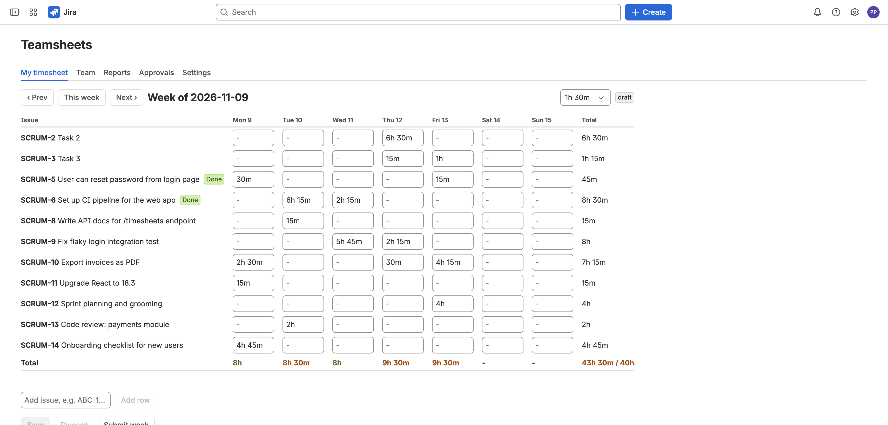
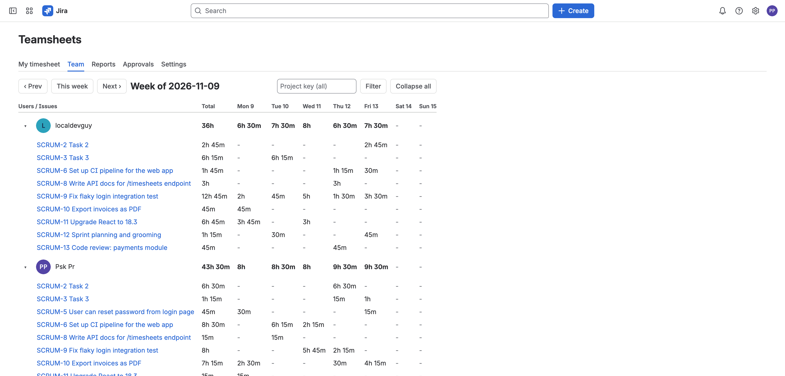
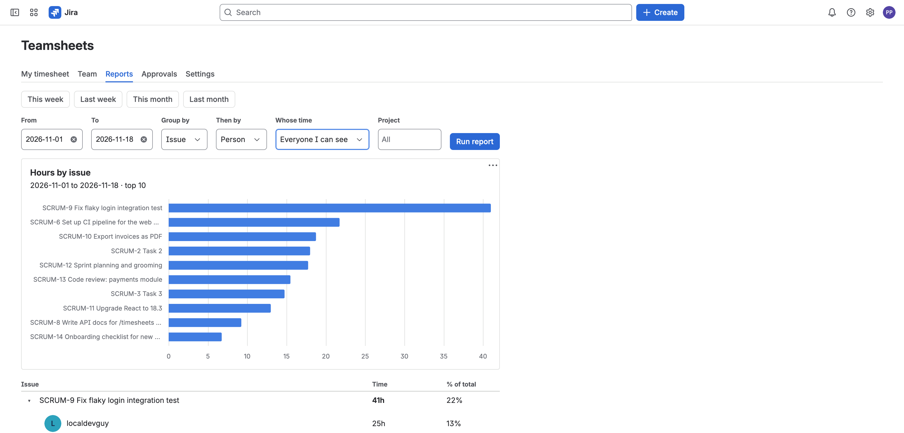
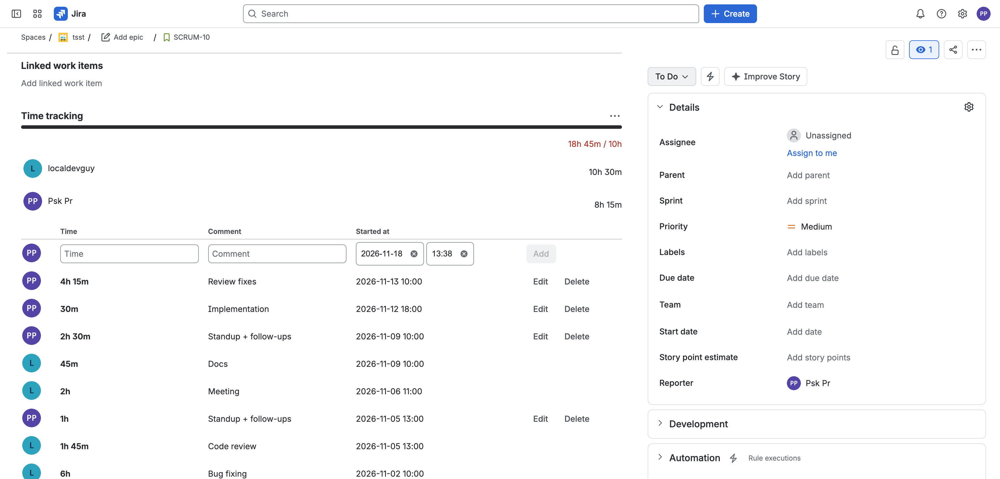
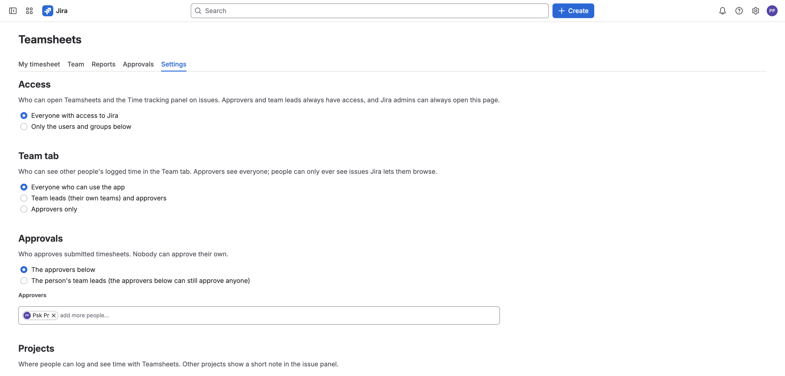

# Teamsheets

Weekly timesheets, approvals and reports for Jira Cloud. Runs on Atlassian: no external servers,
your data stays in Jira.

_Click any screenshot to see it full size._

## Log a week of time in one grid
Totals turn green, orange or red against the hours people are expected to log.

## See the whole team's week
Per person and per issue, with team filters for leads.

## Report on any period
Time by project, issue, epic, person or team, with a chart and a breakdown.

## Log time right on the issue
Estimate progress, per-person totals and your own worklogs to edit.

## Set it up your way
Who can use it, who sees others' time, who approves, expected hours, week start, done issues and more.

---

[Privacy policy](privacy) · [Support](support) ·
[support.teamsheet@gmail.com](mailto:support.teamsheet@gmail.com)
